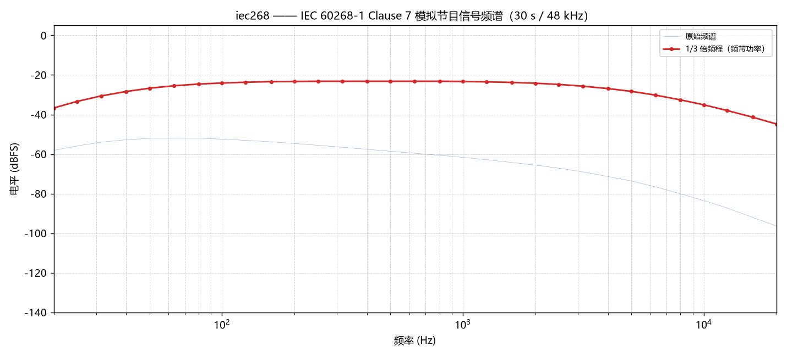
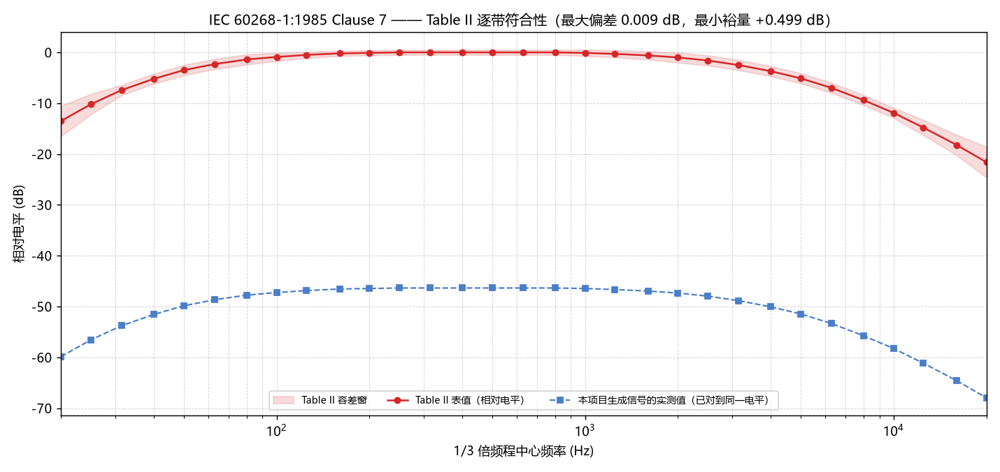
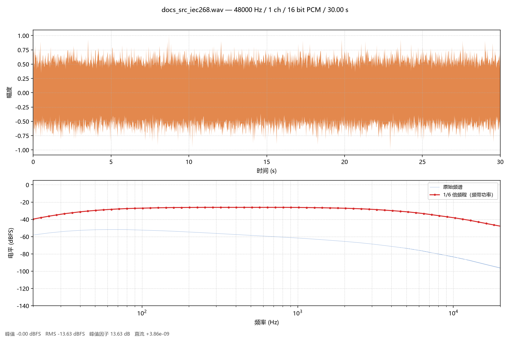

# signal_gen —— 信号生成与分析工具

[](LICENSE)
[](https://www.python.org/)
[](#标准测试信号)

用于音频/声学测试信号标定：生成白/粉/红/蓝噪、多音、扫频、步进扫频、单频正弦，
以及 **EIA RS-426-B / IEC 60268-1** 四种标准测试信号，
并提供频谱分析与 1/6 倍频程电平评估，附带命令行与图形界面两套入口。

---

## 快速开始

```bash
git clone https://github.com/Marcusea26/Signal-gennerator-and-analysis.git
cd Signal-gennerator-and-analysis
pip install -r requirements.txt
```

```bash
# 图形界面
python gui.py

# 命令行
python -m signal_gen list
python -m signal_gen generate pink --duration 10 --seed 42 --normalize rms --target-dbfs -18
python -m signal_gen plot multitone --n-tones 200 --out multitone.png

# 分析一个已有的音频文件（读数 + 倍频程表 + 双栏报告图）
python -m signal_gen analyze output/pink.wav --plot report.png
```

---

## 环境要求

| 项 | 要求 |
|---|---|
| Python | **3.9 及以上**（开发与测试环境为 3.14） |
| 必需依赖 | `numpy>=1.24` |
| 绘图 / 报告图 | `matplotlib>=3.7` |
| 扫频与窗函数 | `scipy>=1.10` |
| 图形界面 | `tkinter`（Windows / macOS 官方发行版自带；Debian/Ubuntu 需 `sudo apt install python3-tk`） |
| 读取非 WAV 格式 | 可选 `soundfile`（FLAC / OGG / AIFF / AU / CAF / MP3 / M4A）—— **WAV 永远零依赖** |
| 信号播放 | 仅 Windows（走内置 `winsound`；其它平台播放按钮自动禁用） |

一键安装全部依赖：

```bash
pip install -r requirements.txt
```

> 只有 **numpy 是硬性依赖** —— `scipy`、`matplotlib`、`tkinter` 都是**延迟导入**的，
> 不装它们照样能 `import signal_gen` 并生成信号（`scipy` 只在画扫频 / 查窗函数时用到，
> `matplotlib` 只在画图时用到，`tkinter` 只在开图形界面时用到）。

---

## 图形界面

```bash
python gui.py
```

界面是**双工作模式**的 —— 左上角的「工作模式」决定左栏显示什么：

| 模式 | 左栏显示 | 图表区 |
|---|---|---|
| **生成信号** | 信号类型 / 通用参数 / 类型专属参数 | 当前生成的信号 |
| **分析文件** | 文件信息（格式 / 采样率 / 声道 / 位深 / 时长 / 路径） | 已打开文件的分析结果 |

* **两种模式的分析口径完全一致** —— 同一套窗函数、同一条倍频程曲线、
  同一张 STFT 图、同一套 dBFS 绝对刻度，所以外部文件与内部生成的信号
  可以直接对照
* **切换到「分析文件」会复用已打开文件的结果**（不重新读盘），
  切回「生成信号」则按当前参数重新生成
* **文件模式下改分析选项（窗函数 / 倍频程阶数 / STFT）重算的是文件本身**，
  不会把打开的文件顶替成新生成的信号
* **左侧参数面板**：选择信号类型后，专属参数自动启用/禁用（不相关控件置灰）；
  面板**支持鼠标滚轮上下滚动**（滚轮事件已被拦截，不会误改下拉框/数字框的值）
* **信号类型用英文命名**（`White Noise` / `Pink Noise` / `Sweep (Chirp)` /
  `EIA RS-426-B Spectral-Weighted Noise` …），下方单独一行中文说明当前类型的用途
* **右侧三个标签页**（标题带上当前来源，便于分辨在看哪个文件）
  * 时域波形 —— 按 **min/max 包络**绘制（每像素列取该列的最大/最小值），
    幅度包络忠实还原，不再出现"某些时间点缺失"的观感
  * 频谱 —— dBFS 绝对刻度，可切换窗函数，**叠加倍频程频带总功率曲线**
    （不再单设倍频程标签页）；倍频程阶数可选 1/1 ~ 1/24，默认 1/6
  * 频谱图 STFT —— 观察扫频的瞬时频率轨迹，纵轴电平与频谱页同一标度
* **起始 / 终止频率对所有类型开放**，含义随信号类型变化，控件标签会跟着换
  （详见下文"起始频率与终止频率"）
* **频率轴默认 20 Hz – 20 kHz**（频谱图 X 轴、STFT 的 Y 轴；
  采样率低于 40 kHz 时自动收敛到奈奎斯特频率以内）
* **底部读数栏**：来源徽章（生成 / 文件）+ 文件名 + 格式信息 + 峰值 / RMS /
  峰值因子 / 直流偏移 / 削波告警；临时状态（"计算中…"）单独占一格，
  **不覆盖读数**
* **窗函数**：下拉框可选 7 种窗（**rectangular（默认）** / hann / hamming /
  blackman / blackmanharris / nuttall / flattop），切换后下方实时显示该窗的
  ENBW 与栅栏损失；频谱、倍频程、STFT 三者使用同一个窗
* **标准测试信号**：下拉框里的 `EIA RS-426-B` / `IEC 60268-1` 四项按标准频谱整形
  生成，峰值因子参数可调（详见下文"标准测试信号"）
* **播放**：点「▶ 播放」直接听当前信号（Windows 内置 `winsound`，异步播放，
  不阻塞界面），**播完自动停止并恢复按钮状态**，无需手动点「■ 停止」；
  音量滑块默认 50%
* **导出**：WAV（16 或 24 bit，可开关 TPDF 抖动）、**当前视图 PNG**、
  **双栏分析报告图**
* **打开音频文件**：分析一个已有的文件（WAV 零依赖；FLAC / OGG / AIFF 等
  装了 `soundfile` 也能读），走的是和生成信号完全相同的频域路径
* **导出分析图**：把当前结果存成一张**双栏报告图**（上半时域 min/max 包络、
  下半频谱 + 倍频程频带功率），可直接贴进测试报告；
  复用界面上已经算好的结果，**不重新分析** —— 长文件也是瞬时的
* **谐波幅度**：单频正弦可填逗号分隔的谐波列表（如 `0.5,0.25`）

参数改完会自动重算（180 ms 去抖），也可按 Enter 或点「重新生成」。

### 播放机制

播完自动停止是这一版新补的行为，实现上踩过一个坑，记录在此避免回退：

* **`SND_SYNC`（同步播放）不可用** —— 它阻塞在播放线程内，跨线程发 `SND_PURGE`
  打不断它（实测 8 秒的音频纹丝不动，直到 7.400 s 后才自行结束），
  「■ 停止」按钮在同步模式下是失效的。
* **MCI（`mciSendString`）同样不可用** —— `play ... wait` 的别名跨线程不通，
  `stop` 返回 rc=263。
* **最终方案：`SND_ASYNC` + `SND_PURGE` + 墙钟定时器**
  —— 异步播放能被 `SND_PURGE` 立刻打断（实测停止后仅播放 0.419 s）；
  同时用一个 `threading.Timer` 按 `时长 + 0.35 s` 触发完成回调，
  多出的 0.35 s 用于覆盖声卡缓冲排空（实测声卡固定开销约 +0.25 s）。
  界面侧再以 100 ms 轮询播放器状态，播完自动把按钮切回「▶ 播放」并清理临时 WAV。

### 性能

计算全部在后台线程完成，界面在计算期间仍可拖动、切换标签页：

| 环节 | 旧版 | 现版 |
|---|---|---|
| 频域分析（2 次 FFT → 1 次 + 二分分频带） | 32 ms | 16 ms |
| 单次重算主线程阻塞 | 587 ~ 1713 ms（越用越慢） | 130 ~ 210 ms（恒定） |
| STFT 网格规模 | 60 万格 | 10 万格 |

> 旧版每次重绘都新建一个 colorbar 坐标轴，而 `ax.clear()` 并不会删除它，
> 用得越久坐标轴越多、界面越卡 —— 现版改为色条常驻复用，坐标轴数量恒定。
>
> 阻塞时长的**绝对值**随机器负载浮动（同一台机器上开发时测到 74 ~ 81 ms，
> 负载较高时 130 ~ 210 ms），关键是它**不再随使用次数退化**，且 12 种信号类型
> 之间没有差别（标准信号 148 ~ 160 ms，与既有类型 136 ~ 211 ms 同量级）。

---

## 起始频率与终止频率

**所有信号类型都能设置起始频率与终止频率**，但这两个参数在不同类型下含义不同，
所以 GUI 的控件标签会随类型一起切换：

| 类型 | `起始频率` | `终止频率` | 默认值 |
|---|---|---|---|
| `white` / `pink` / `red` / `blue` | 带限下限 | 带限上限 | 20 Hz – 20 kHz |
| `multitone` | 最低音调 | 最高音调 | 20 Hz – 20 kHz |
| `sweep` | 扫频起点 | 扫频终点 | 20 Hz – 20 kHz |
| `stepped` | 台阶起点 | 台阶终点 | 20 Hz – 20 kHz |
| `sine` | **信号频率** | （置灰，单频信号没有终止频率） | 1000 Hz |
| `eia426b` | 高通拐点（-3 dB，标准值 40 Hz） | 低通拐点（-3 dB，标准值 10 kHz） | 40 Hz – 10 kHz |
| `iec268` | 纳入整形的最低 1/3 倍频程频带 | 最高 1/3 倍频程频带 | 20 Hz – 20 kHz |
| `iec268_fig2` | 纳入整形的最低 1/3 倍频程频带 | 最高 1/3 倍频程频带 | 20 Hz – 20 kHz |
| `iec268_pink` | 高通拐点（-3 dB，标准值 22.7 Hz） | 低通拐点（-3 dB，标准值 22.4 kHz） | 22.7 Hz – 22.4 kHz |

### 宽带噪声的带限

噪声的频带限制是**在频域直接乘权重**（砖墙 + 1/24 倍频程的 raised-cosine 过渡带），
**不是**先滤波再截断：

* **带内完全平坦**（权重恒为 1），1/f 谱斜率一点不受影响 ——
  实测粉噪 −3.03 dB/oct、红噪 −6.04 dB/oct、蓝噪 +2.99 dB/oct；
* **没有滤波器启动瞬态**，也不会引入边界咔哒声；
* 过渡带只有 1/24 倍频程（约 2.9 %）—— 这不是为了"好听"，而是因为
  **任何带滚降的高通都会破坏谱斜率**：Butterworth 高通在 20 Hz 拐点会让
  100 Hz 处低 28 dB，1/f 曲线直接被压弯。砖墙式过渡对带内只有 0.01 dB 量级的影响。

白噪也走同一条频域生成路径（`β = 0`），所以带限对白噪同样生效；
时域高斯白噪与频域平坦谱在统计上等价（bin 幅度服从瑞利分布），
但只有频域做法才能做带限整形。

> ⚠ **默认行为变化**：白/粉/红/蓝噪现在默认限制在 **20 Hz – 20 kHz**。
> 需要全频带噪声时把带限上限调到奈奎斯特频率以下即可
> （例如 `--f-start 1 --f-stop 24000`）。

### 标准信号的频带参数化

四种标准信号的默认值**恰好就是标准值**，因此默认行为就是严格合规的标准信号；
一旦改动，工具会明确提示"已不再是严格合规的标准信号"：

* `iec268` / `iec268_fig2` —— 两个参数限定"纳入整形的 1/3 倍频程频带范围"，
  默认 20 Hz – 20 kHz 就是 Clause 7 **Table II 的全部 31 个频带**
  （频带掩码按 ANSI S1.11 / IEC 61260 的标准频带边界整带取舍，绝不切半个频带）；
* `iec268_pink` —— 两个参数直接作为 Butterworth 的 **-3 dB 拐点**
  （标准值 22.7 Hz / 22.4 kHz）；
* `eia426b` —— 两个参数是 40 Hz 高通与 10 kHz 低通的 **-3 dB 拐点**，
  标准把频带固定为 **40 Hz – 10 kHz**，改动即偏离标准。

---

## 扫频信号频谱图"头尾变暗"的原因

这是**有意为之**的结果，不是 bug。

**第一层：Tukey 渐变（主因）。** 连续扫频整段首尾加了渐变（默认
`渐变比例 = 0.05`，即首尾各 2.5 %）。它用来抑制扫频首尾的阶跃不连续 ——
不加渐变的话，信号从静音直接跳到满幅会产生宽带咔哒声，在频谱图上表现为
整个低频段的"谱溅"。

渐变区在 STFT 上是**实打实的幅度衰减**，所以首尾几个时间切片必然偏暗。实测
（5 s @ 48 kHz，300 个时间切片，`渐变比例 = 0.05`）：

| 时间切片 | 1 | 2 | 3 | … | 299 | 300 |
|---|---|---|---|---|---|---|
| 电平 (dBFS) | **−36.5** | **−17.9** | −12.7 | … | −25.3 | **−35.3** |

把渐变比例调成 0，衰减立刻消失（头部 −5.8 dB、尾部 −3.9 dB，与中段同量级），
代价是首尾会出现不连续。

**第二层：log 扫频的边缘效应。** 即使去掉渐变，频谱图两端仍然偏低，
原因与扫频方式本身有关：极值频率只停留极短时间。按理想 −1.5 dB/oct 的
幅度斜率外推，20 Hz 处应读到 −28.5 dBFS，实测却是 −95 dBFS；
20 kHz 处应为 −94 dBFS，实测 −185 dBFS。这是 log 扫频的固有性质，
不是生成器的缺陷。

---

## 标准测试信号

四种**扬声器功率承载 / 最佳功放功率**测试用的标准激励信号，全部按标准给定的
频谱整形生成，而不是凭印象近似。

> **峰值因子（Crest Factor）** = 峰值与 RMS 之比的 dB 值（`20·log10(peak / rms)`），
> 衡量波形"多尖"。本项目里 `crest_factor_db` 参数、GUI 的「峰值因子 (dB)」、CLI 的
> `--crest-factor-db`、报告图的「峰值因子」读数，指的都是这一个量。

| 类型 | 标准 | 频谱定义 | 峰值因子 |
|---|---|---|---|
| `eia426b` | ANSI/CTA-426-B（1998）*Loudspeakers, Optimum Amplifier Power*，加速寿命测试信号 | **频谱加权高斯噪声**（不是带通粉噪）：以恒定百分比带宽分析仪读数为准，**40 Hz – 1 kHz 平坦**、**1 kHz – 10 kHz 按 3 dB/octave（10 dB/decade）滚降**；限带由 40 Hz 高通（≥6 阶）与 10 kHz 低通（≥4 阶）Butterworth 完成 | **6 dB**（软削波，Keele Eq. 1） |
| `iec268` | IEC 60268-1:1985 **Clause 7** *Sound system equipment - Part 1* | **模拟节目信号**（simulated programme signal）：按 **Table II** 的 1/3 倍频程相对电平表（31 个频带）整形的**平稳加权高斯噪声**，功率谱密度在 lg f 上是分段直线，节点经迭代拟合使每个频带的闭式积分**正好等于表值** | 标准要求 *"without amplitude limiting"* → **默认不限幅（0 dB）** |
| `iec268_fig2` | 同上，但采用标准 **Figure 1 / Figure 2** 给出的**无源 RC 梯形网络**实现 | 粉噪（功率谱 ∝ 1/f）经 Figure 2 电路（源阻抗 430 Ω、串联 2.2 µF、节点 A 并联 3.3 kΩ + 91 nF、串联 330 Ω + 2.2 µF、节点 B 并联 3.3 kΩ + 68 nF、串联 0.47 µF、10 kΩ 输出电阻） | 同上 → **默认不限幅（0 dB）** |
| `iec268_pink` | IEC 60268-1 **附录 C** / IEC 60065；功率测试见 IEC 60268-5 | 带限粉噪：**12 dB/oct 高通**（-3 dB @ 22.7 Hz）+ **18 dB/oct 低通**（-3 dB @ 22.4 kHz），22.4 Hz – 22.4 kHz 基本平坦 | **6 dB**（2:1，clipped pink noise） |

`iec268` 生成后的频谱形状，以及按标准 1/3 倍频程滤波带实测的分带功率
（30 s / 48 kHz，不加窗 DFT 分箱积分）：



与 Table II 的逐带对照 —— 红色是标准表值与容差窗，方块是本项目生成信号的实测值
（已对到同一电平）：



> ### IEC 60268-1 有**两种**不同的信号，别搞混
>
> IEC 60268-1 里有两个常被混为一谈的东西：
>
> * **Clause 7 模拟节目信号**（`iec268` / `iec268_fig2`）—— 这是"节目电平"的
>   参考信号，标准用 **Table II**（31 个 1/3 倍频程频带的**相对电平**加容差）
>   和 **Figure 1 / Figure 2** 来定义。Clause 7 原文：
>
>   > *A signal, whose mean power spectral density closely resembles the
>   > average of the mean power spectral densities of a wide range of
>   > programme material, including both speech and music of several kinds,
>   > is stationary weighted Gaussian noise without amplitude limiting, the
>   > weighted power spectrum being in accordance with Table II and Figure 1,
>   > page 22, when measured with third-octave filters in accordance with IEC
>   > Publication 225.*
>
>   两个关键词：**"stationary weighted Gaussian noise"**（平稳加权高斯噪声）与
>   **"without amplitude limiting"**（不做幅度限制）。后者就是本项目把
>   `iec268` 的峰值因子默认设为 **0** 的依据 —— 这与 EIA RS-426-B 的
>   "soft clipped to a crest factor of 6 dB" 恰好相反。
>
> * **附录 C / IEC 60065 带限粉噪**（`iec268_pink`）—— 只规定**滤波器**的频响
>   （22.4 Hz – 22.4 kHz 基本平坦），本身不含 Table II 那种逐带电平表，
>   是 IEC 60268-5 功率承载测试（"clipped pink noise"，峰值因子 2:1）用的激励。
>
> 两者**频谱形状完全不同**：把附录 C 的粉噪拿去量 Table II，最差频带会差
> **−8.2 dB**，根本不合格。本项目把两者拆成两个独立的信号类型，
> 就是为了让"节目信号"和"功率测试信号"不再被混为一谈。
>
> 需要"带附加削波"的节目信号（例如 IEC 60268-7:2010 8.3.2 规定耳机的
> *"with additional clipping"*、peak-to-r.m.s. 1.8 ~ 2.2，即峰值因子约
> **5.1 ~ 6.9 dB**）时，显式给 `--crest-factor-db` 即可 —— 默认值保持标准原样的不限幅。

> ### EIA RS-426-B 不是"带通粉噪"
>
> 早期版本把 EIA-426-B 实现成"粉噪 + 12 dB/oct 带通"，与标准不符，有两处硬伤：
>
> 1. **频带不对**。标准限带是固定的 **40 Hz – 10 kHz**（由至少 6 阶的 40 Hz
>    Butterworth 高通与至少 4 阶的 10 kHz Butterworth 低通完成），
>    不是"Fs → 10·Fs"（那是 AES2 对更早的 426-A / 一般性"最佳功放功率"
>    测试的概括说法）。
> 2. **高频斜率不对**。标准的加权曲线在 1 kHz 以上还要**再叠加一段 1/f 的
>    功率谱倾斜**：40 Hz – 1 kHz 段功率谱 ∝ 1/f（读数平坦），
>    1 kHz – 10 kHz 段功率谱 ∝ 1/f²（读数 −3 dB/octave）。
>    做成带通粉噪的话，1 kHz 以上会一直保持平坦，高频能量比标准多出
>    整整一个倍频程的斜率。
>
> 依据是 D. B. Keele 的论文（他受委托编写了 ANSI/EIA-426-B 的测试信号条款
> 并制作了配套测试 CD），论文逐条转述了标准原文：
>
> > *For the accelerated life test track 2, the standard specifies
> > spectral-weighted Gaussian noise, soft clipped to a crest factor of 6 dB
> > and lasting for 30 minutes.*
> >
> > *The specified weighting (as measured by a constant percentage bandwidth
> > analyzer), bandlimits the noise to 40 Hz and 10 kHz, is flat between
> > 40 Hz and 1 kHz, and then rolls off at 3 dB/octave (10 dB/decade)
> > between 1 kHz and 10 kHz. The band limiting is accomplished by a 40-Hz
> > high-pass filter of at least 6th-order minimum and a 10-kHz low-pass
> > filter of at least 4th-order minimum, both maximally-flat Butterworth types.*

```bash
# EIA RS-426-B 寿命测试噪声（标准频带固定 40 Hz – 10 kHz）
python -m signal_gen generate eia426b --duration 60

# IEC 60268-1 Clause 7 模拟节目信号（按 Table II 逐带整形，默认不限幅）
python -m signal_gen generate iec268 --duration 60

# 同一信号的 Figure 2 无源 RC 电路实现
python -m signal_gen generate iec268_fig2 --duration 60

# IEC 60268-1 附录 C 带限粉噪（IEC 60268-5 功率测试用，峰值因子 2:1）
python -m signal_gen generate iec268_pink --duration 60

# 峰值因子可调（0 = 不限幅）
# Clause 7 要求"不做幅度限制"，所以 iec268 默认不限幅；
# 需要"带附加削波"（如 IEC 60268-7:2010 8.3.2）时显式指定：
python -m signal_gen generate iec268 --crest-factor-db 6 --duration 60
```

### 实现要点

* **全频域整形** —— 粉噪幅度 ∝ f^-0.5 直接乘滤波器的 Butterworth 解析幅度响应。
  没有滤波器的启动瞬态，响应严格等于标准曲线（实测拐点 -3.07 / -2.93 dB）。
* **EIA 的加权谱分两段** —— 40 Hz – 1 kHz 段幅度 ∝ f^-0.5（功率谱 ∝ 1/f，
  1/3 倍频程读数平坦），1 kHz 以上再乘 `(1 kHz / f)^0.5`（功率谱 ∝ 1/f²，
  读数 −3 dB/octave）。实测 **63 Hz – 1 kHz** 的 1/3 倍频程读数起伏仅
  **0.12 ~ 0.19 dB**（10 s / 30 s / 60 s × 3 个 seed），1.2 kHz – 6 kHz 的斜率为
  **−9.79 ~ −9.88 dB/decade**（标准要求 −10 dB/decade）。
  50 Hz 频带读数比平台低 **约 0.4 dB** —— 那不是整形误差，而是 6 阶 40 Hz 高通的
  过渡带（50 Hz 距拐点仅 0.25 倍频程）造成的，标准限带点本身就是 40 Hz。
* **EIA 用软削波而不是硬削波** —— 标准写的是 *soft clipped*，对应 Keele
  论文 Eq.(1) 的输入输出函数 `y = sign(x)·|x| / (1 + |x|^k)^(1/k)`（k = 4）。
  实现方式是二分输入增益，使削波后的 `peak / rms` 精确命中 6 dB。
  软削波得到的是**圆拐点**，峭度（kurtosis）实测 **−0.929 ~ −0.936** ——
  与 Keele 实测他生成的 CD 轨道（`V_kurt = -0.931`）吻合到 0.005 以内；
  硬削波的峭度只有 −0.626，峰值附近的概率密度会在阈值处堆积。
* **EIA 的绝对电平** —— 标准规定噪声 RMS 比 1 kHz 校准音低 3 dB；又因峰值因子
  6 dB，噪声**峰值与校准音峰值相同**。本实现按此给出**峰值 −6 dBFS、
  RMS −12 dBFS**（`normalize="none"` 时可见；默认的峰值归一化会整体放大到
  0 dBFS，形状与峰值因子不变）。
* **滚降斜率按 dB/oct 定义** —— 解析式 `|H| = 1/√(1+(f/fc)^(2N))` 里的 `N` 是**极点数**，
  渐近斜率为 `6·N dB/oct`。因此 12 dB/oct ⇒ N=2、18 dB/oct ⇒ N=3
  （IEC 60268-1 附录 C 带限粉噪的高通 / 低通）；
  EIA 的 40 Hz 高通为 6 阶（36 dB/oct，标准要求 ≥6 阶）、10 kHz 低通为 6 阶。
  （早前误把"12 dB/oct"当成"6 阶"，实际做成 36/54 dB/oct，比标准陡 3 倍。）
* **峰值因子靠削波实现** —— 高斯噪声在长记录上天然有 14 ~ 16 dB 峰值因子，
  标准要求 6 dB。IEC 60268-5 用二分法求硬削波阈值，使
  `peak / rms(clip(x, ±T))` 精确命中目标，实测 12 组（3 类型 × 2 目标 × 2 seed）
  全部精确到 **0.001 dB**。
* **Clause 7 节目信号不做幅度限制** —— 标准原文 *"without amplitude limiting"*，
  所以 `iec268` / `iec268_fig2` 的峰值因子默认 **0**。实测 5 s / 48 kHz 的
  峰值因子 **12.8 ~ 12.9 dB**（未限幅的高斯噪声本来的样子）。
  只有显式给了 `--crest-factor-db` 才做硬削波（对应 IEC 60268-7:2010 8.3.2
  那种 *"with additional clipping"* 的用法）。
* **Clause 7 的 Table II 是逐带精确的** —— 实现方式是把功率谱密度在 lg f 上
  建成**分段直线**，再用**不动点迭代**拟合节点（容差 1e-10 dB，残差 2.6e-11 dB），
  使每个 1/3 倍频程频带的**闭式积分正好等于表值**。
  于是"目标 PSD 积分 → 表值"这一步没有任何近似：
  数值积分复核时逐带最大误差 **0.0005 dB**，31 个频带的总功率 **12.5589 dB**
  （标准注里说的是"约 12.5 dB"，表值精确和为 12.5576 dB）。
* **节目信号不做逐带经验校准** —— Clause 7 描述的是**平稳**加权高斯噪声，
  它的"期望频谱"就是 Table II；有限记录的统计涨落属于正常现象，
  不该被强行抹平。所以本实现给的是**符合性判定**
  （`check_iec268_program()`：整体电平偏移、各带偏差、裕量、最紧的频带），
  而不是"每次生成都把读数硬拉到表值"。
  实测 30 s / 48 kHz 记录逐带最大偏差 **0.009 dB**（10 s 为 0.022 dB），
  距最窄的那条容差（±0.5 dB）还有 **+0.50 dB** 裕量。
* **Figure 2 是"一种实现"，Table II 才是"定义"** —— `iec268_fig2` 用标准的
  无源 RC 梯形网络（源阻抗 430 Ω、串联 2.2 µF、节点 A 并联 3.3 kΩ + 91 nF、
  串联 330 Ω + 2.2 µF、节点 B 并联 3.3 kΩ + 68 nF、串联 0.47 µF、
  10 kΩ 输出电阻）实现。实测它**同样落在 Table II 容差内**，但裕量只剩
  **+0.18 dB** —— 电路实现在最差频带几乎贴着容差限，短记录甚至可能越界。
  这正好说明为什么标准同时给了"表"和"电路"：表是定义，电路是参考实现。
* **频带边界用 ANSI S1.11 / IEC 61260 的标准定义** —— 1/3 倍频程滤波带按
  "精确中心 `1000·10^(n/10)` × `10^(±0.05)`"划分（1000 Hz 频带 = 891.3 – 1122 Hz，
  20 kHz 频带 = 17783 – 22387 Hz），相邻频带**严丝合缝**（既不重叠也不留洞），
  所以整形、校准与验收用的是同一组边界，真实分析仪读到的分带功率逐项等于标准表。
  早前用的"名义中心 × `2^(±1/6)`"会重叠 0.79 %、并留下最大 1.57 % 的空洞
  （12.5 kHz 与 16 kHz 之间有 223.6 Hz 的死区），那不是标准频带。
* **低通拐点跟随奈奎斯特** —— 采样率不足时，IEC 60268-1 与 EIA RS-426-B 的
  低通拐点自动压到 `0.99·fs/2`（fs=16 kHz → 7.92 kHz），否则整形目标落在
  可还原频率范围之外。

### 标准来源

| 标准 | 说明 |
|---|---|
| ANSI/CTA-426-B (1998) | "Loudspeakers, Optimum Amplifier Power"。加速寿命测试信号为频谱加权高斯噪声（软削波、峰值因子 6 dB、30 分钟）；此外标准还包含 40 Hz – 10 kHz 变速扫频的功率压缩测试、失真测试纯音与形状音脉冲；功率按**标称阻抗**计算。本项目只实现寿命测试的噪声激励信号。 |
| IEC 60268-1:1985 Clause 7 | *Sound system equipment - Part 1*，Clause 7 "Simulated programme signal"：**平稳加权高斯噪声、不做幅度限制**，加权功率谱按 **Table II**（31 个 1/3 倍频程频带的相对电平 + 容差）与 **Figure 1** 定义，用符合 **IEC Publication 225** 的 1/3 倍频程滤波器测量；**Figure 2** 给出实现该频谱的参考无源 RC 网络。本项目实现了 `iec268`（Table II 逐带精确）与 `iec268_fig2`（Figure 2 电路）两种。 |
| IEC 60268-1 附录 C / IEC 60065；IEC 60268-5 | 带限粉噪滤波器的频响定义（22.4 Hz – 22.4 kHz 基本平坦）与 "clipped pink noise" 功率测试方法（峰值因子 2:1）。对应本项目的 `iec268_pink`。 |
| IEC 60268-7:2010 8.3.2 | 耳机的模拟节目信号要求 *"with additional clipping"*、peak-to-r.m.s. 1.8 ~ 2.2（峰值因子约 5.1 ~ 6.9 dB） —— 这是 Clause 7 节目信号**需要额外限幅**的具体场合，本项目用 `--crest-factor-db` 覆盖。 |

标准原文均为付费文本，本项目的实现依据是下列**公开可查**的资料：

| 依据 | 用途 |
|---|---|
| **D. B. Keele《Development of Test Signals for EIA-426-B》**（AES 111th Convention, 2001，预印本） | **EIA RS-426-B 的主要依据**：逐条转述标准对寿命测试噪声的规定（加权谱形状、40 Hz/10 kHz 限带与滤波器阶数、软削波与 6 dB 峰值因子、RMS 相对电平），并给出 Eq.(1) 软削波函数、Fig. 6 计算所得的 1/3 倍频程频谱、Fig. 18 实测 CD 频谱（该预印本未随本仓库分发，请自行从 AES 检索） |
| **phonometry 文档《Program Signal》**（José Manuel Requena Plens，<https://docs.jmrp.io/phonometry/reference/api/electroacoustics/program-signal/>） | **IEC 60268-1 Clause 7 节目信号的主要依据**：给出 Table II 的全部相对电平与容差、Table II 功率和 ≈ 12.5 dB、Figure 2 的元件值与网络结构、以及"用 Figure 2 电路实现时最差频带仍落在容差内、但裕量只有约 0.18 dB"的实测结论。本项目的 `iec268_fig2` 实测裕量 **+0.178 dB**，与该文档完全一致 |
| **phonometry 源码 `electroacoustics/program_signal.py`**（<https://github.com/jmrplens/phonometry>） | Table II 的**原始数值**、Figure 2 的元件常量、以及用节点方程实现整形的算法细节；本项目的分段直线 PSD 定义与不动点节点拟合即据此而来 |
| Scan-Speak *Technical Note 02 – Performing power tests* | 明确 IEC 60268-5 的测试信号是"经 IEC 268-1 加权的粉噪，峰值因子 2:1" |
| Rod Elliott / ESP《Pink Noise Generator for Audio Testing》 | 引 IEC 60065 Annex C（IEC 60268-1 的摘录）：滤波器在 **22.4 Hz – 22.4 kHz** 基本平坦，12 dB/oct 高通 @ 22.7 Hz、18 dB/oct 低通 @ 24.1 kHz |
| EAW *Power Handling*（引 AES2-1984 / 1994） | "pink noise filtered with a **12 dB/octave** Butterworth filter, both high and low, 1 decade apart"，峰值因子 6 dB —— 这是**早期版本**对 EIA 的误读来源 |
| ANSI S1.11-2004 / IEC 61260-1 | 1/3 倍频程频带边界表（精确中心 × `10^(±0.05)`） |

> **置信度说明**：
>
> * IEC 60268-1 低通的 -3 dB 点，公开资料只能确认"滤波器在 22.4 Hz – 22.4 kHz
>   基本平坦"且工程实现取 24.1 kHz；本项目取标准的通带上沿 **22.4 kHz**
>   作为名义值（更保守的一端）。
> * **Clause 7 的 Table II 数值本身有二手来源的明确背书**：phonometry 的
>   `program_signal.py` 源码里带着完整表格与 Figure 2 的元件常量，
>   其"用 Figure 2 电路实现时最差频带余量约 0.18 dB"的结论与本项目
>   `iec268_fig2` 的实测值 **+0.178 dB** 相互印证。Table II 的**容差**在
>   二手资料中同样可查，本项目按表值 ± 容差逐带判定符合性。
> * 但要注意**口径**：Table II 给的是**相对电平**（以某一频带为基准），
>   不是绝对 dB 值，所以符合性判据是"存在一个统一电平偏移，能把所有频带
>   都放进各自的容差窗"。本实现的 `check_iec268_program()` 就是这么判的
>   （给出 `offset_db` / `deviations_db` / `margin_db` / `binding_bands_hz` /
>   `passes`）。实测 `iec268` 的裕量 **+0.50 dB**、`iec268_fig2` **+0.18 dB**、
>   `iec268_pink` **−8.24 dB**（不合格）。
> * **不做逐带经验校准**是刻意的取舍：Clause 7 描述的是**平稳**加权高斯噪声，
>   有限记录的统计涨落属于正常现象（30 s 记录逐带最大偏差 0.009 dB），
>   强行校准会掩盖这一点。本项目给判定工具，而不是给"永远落在表值上"的假象。
> * Figure 2 的传递函数按**三节点方程闭式解**实现，只取幅度（电阻电容网络的
>   相位对平稳高斯噪声没有意义，保持共轭对称才能保证实信号）。
>   通带损耗实测约 **−4.2 dB @ 1 kHz**，20 kHz 处 **−24.9 dB**。
> * EIA RS-426-B 的标准全文仍未公开，但 Keele 论文是**受托编写该标准测试信号
>   条款**的作者对标准原文的逐条转述，并附有实测数据，可信度高。本实现的频谱
>   与 Keele 论文 Fig. 6（他计算所得的 1/3 倍频程频谱）逐带对照（以 250 Hz 频带
>   对齐参考电平），最大偏差 **1.4 ~ 1.5 dB**（31.5 Hz – 10 kHz 区间，3 个 seed）；
>   峭度实测 −0.929 ~ −0.936，Keele 实测 −0.931。
>   论文步骤 4 对整形滤波器的文字描述与它自己给出的实测曲线并不自洽（标准
>   明确以"恒定百分比带宽分析仪读数"为准），因此本实现按**标准规定的读数
>   曲线**整形，而不是照抄论文的模拟滤波器级联。


---

## 命令行

### 子命令

| 命令 | 说明 |
|---|---|
| `list` | 列出所有信号类型 |
| `generate` | 生成信号并写入 WAV |
| `plot` | 生成信号并绘制频谱图 PNG |
| `analyze` | **分析一个已有的音频文件**（读数 + 倍频程表 + 可选报告图） |

### 信号类型

| 类型 | 说明 | 关键参数 |
|---|---|---|
| `white` | 白噪声，S(f) 恒定 | `--duration` `--seed` `--f-start` `--f-stop` |
| `pink` | 粉噪声，S(f) ∝ 1/f | `--beta` `--f-start` `--f-stop` |
| `red` | 红/布朗噪声，S(f) ∝ 1/f² | `--beta` `--f-start` `--f-stop` |
| `blue` | 蓝噪声，S(f) ∝ f | `--beta` `--f-start` `--f-stop` |
| `multitone` | 对数分布多音叠加 | `--n-tones` `--f-start` `--f-stop` |
| `sweep` | 连续扫频 chirp | `--sweep-method log\|linear` `--f-start` `--f-stop` |
| `stepped` | 步进扫频 | `--n-steps` `--step-duration` `--f-start` `--f-stop` |
| `sine` | 单频正弦 | `--f-start`（等价于 `--f1`）`--amplitude` |
| `eia426b` | EIA RS-426-B 频谱加权噪声（40 Hz–10 kHz，1 kHz 以上 −3 dB/oct） | `--f-start` `--f-stop` `--crest-factor-db` |
| `iec268` | IEC 60268-1 Clause 7 模拟节目信号（Table II 逐带精确，默认不限幅） | `--f-start` `--f-stop` `--crest-factor-db` |
| `iec268_fig2` | IEC 60268-1 Clause 7 模拟节目信号（Figure 2 无源 RC 电路实现） | `--f-start` `--f-stop` `--crest-factor-db` |
| `iec268_pink` | IEC 60268-1 附录 C 带限粉噪（峰值因子 2:1） | `--f-start` `--f-stop` `--crest-factor-db` |

> 命令行的默认参数**按信号类型**取值（来自 `DEFAULT_PARAMS`）：
> 红噪的 `--beta` 默认 2.0、连续扫频的 `--fade-ratio` 默认 0.05、
> `iec268` 的频带默认 20 Hz – 20 kHz（Table II 的 31 个频带）、
> `iec268_pink` 的频带默认 22.7 Hz – 22.4 kHz，等等 —— 与 GUI 完全一致。

### 常用参数

```
--fs 48000              采样率
--duration 5            时长（秒）
--seed 42               随机种子（相同种子输出完全一致）
--f-start 20            起始频率（Hz），含义随类型而变
--f-stop 20000          终止频率（Hz），含义随类型而变（单频正弦不适用）
--beta 1                噪声谱斜率 β（S∝f^-β）：0 白 / 1 粉 / 2 红 / -1 蓝
--normalize peak|rms|none    归一化方式
--target-dbfs -18       rms 模式的目标电平
--crest-factor-db 6     峰值因子 (dB)，0 = 不限幅（按信号类型取标准默认值）
--harmonics 0.5,0.25    谐波相对幅度列表（逗号分隔，仅单频正弦有效）
--bits 16|24            导出位深
--no-dither             关闭 TPDF 抖动
--out 路径              输出文件（相对路径写入 output/ 目录）
```

`plot` 子命令另带 `--window`（分析用窗函数，默认 `rectangular`，
可选 rectangular / hann / hamming / blackman / blackmanharris / nuttall / flattop）。

`analyze` 子命令另带 `--window` / `--order`（倍频程阶数：1 / 3 / 6 / 12 / 24）/
`--f-min` / `--f-max` / `--plot PNG`（额外导出一张双栏分析报告图）。

### 示例

```bash
# 标准 1/f 粉噪，-18 dBFS RMS，16 bit
python -m signal_gen generate pink --duration 10 --seed 42 \
    --normalize rms --target-dbfs -18 --out pink_10s.wav

# 50 台阶步进扫频，24 bit
python -m signal_gen generate stepped --n-steps 50 --step-duration 0.5 \
    --seed 42 --bits 24 --out stepped.wav

# 线性扫频 + 频谱图
python -m signal_gen plot sweep --sweep-method linear --duration 2 --out linear.png

# EIA RS-426-B 寿命测试噪声（标准频带固定 40 Hz – 10 kHz）
python -m signal_gen generate eia426b --duration 60

# 限制粉噪的频带（20 Hz – 20 kHz 是默认值，这里收窄到 200 Hz – 2 kHz）
python -m signal_gen generate pink --f-start 200 --f-stop 2000 --duration 10

# 单频正弦：起始频率就是信号频率
python -m signal_gen generate sine --f-start 500 --duration 5

# 分析一个已有的 WAV（读数 + 1/6 倍频程频带功率表）
python -m signal_gen analyze output/pink_10s.wav

# 用 1/3 倍频程看
python -m signal_gen analyze output/pink_10s.wav --order 3

# 同时导出一张双栏分析报告图（时域包络 + 频谱含 1/6 倍频程）
python -m signal_gen analyze output/pink_10s.wav --plot output/report.png
```

---

## 分析已有的音频文件

```bash
python -m signal_gen analyze output/pink.wav
```

输出包含文件信息（采样率 / 声道 / 位深 / 时长）、读数
（峰值 / RMS / 峰值因子 / 直流偏移）、以及整张倍频程频带功率表。

加 `--plot report.png` 还能额外导出一张**双栏分析报告图**：
上半是时域 min/max 包络，下半是频谱并叠加 1/6 倍频程频带功率曲线，
标题行给出文件格式信息，底部给出峰值 / RMS / 峰值因子 / 直流偏移读数。



GUI 里点「打开 WAV」即可，**走的是和生成信号完全相同的频域分析路径**
（同一套窗函数、同一条 1/6 倍频程曲线、同一张 STFT 图），
所以外部文件与内部生成的信号可以直接对比；
点「导出分析图」得到的就是同一张双栏报告图。

支持的格式：

| 编码 | 位深 | 说明 |
|---|---|---|
| PCM | 8 / 16 / 24 / 32 bit | 8 bit 是无符号的（中点 128） |
| IEEE 浮点 | 32 / 64 bit | 很多音频软件导出的格式 |
| WAVE_FORMAT_EXTENSIBLE | 同上 | 按其 SubFormat 判定 |
| RF64 / ds64 | 同上 | 大文件的 64 位长度声明 |

多声道文件会**下混成单声道**（各声道取平均）—— 分析用的都是单声道数据。

### 其它音频格式（可选依赖）

`load_audio` / `audio_info` 不止认 WAV：只要环境里装了 `soundfile`
（即 libsndfile），FLAC / OGG / AIFF / AU / CAF / MP3 / M4A 也能直接读：

```bash
pip install soundfile
python -m signal_gen analyze 某文件.flac --plot report.png
```

**WAV 永远不需要任何第三方依赖** —— 走的是自研的 RIFF 解析器（还支持
标准库 `wave` 不认的 IEEE 浮点 WAV）。没装 soundfile 时读非 WAV 文件会得到
一条中文提示（`pip install soundfile`），而不是抛 `ImportError`。

### 与早期独立脚本的差异

`legacy/read signal.py` 是本项目早期的一份「读外部文件 → 分析 → 画图」脚本，
它的**工作流已经并入** `signal_gen.report`，但实现没有照搬 —— 旧脚本有四处问题：

| 项 | 旧脚本 | 现版 |
|---|---|---|
| 1/6 倍频程口径 | 对**幅度谱**做算术平均，读数比标准口径低 **36 ~ 38 dB** | 频带**功率积分**（IEC 61260 / ANSI S1.11），满幅正弦读 **0.00 dBFS** |
| 性能 | 逐频点 Python 循环 + `searchsorted`，300 s / 48 kHz 实测 **23.5 s** | 频带归属改用二分定位，同一文件 **毫秒级**（约 500 倍差距） |
| 依赖 | 必须装 `soundfile` 才能跑 | WAV 零依赖，其它格式才需要 soundfile |
| 刻度 | 先把波形归一化到峰值 1.0，**绝对刻度丢失** | 保持 dBFS 绝对刻度，与生成信号可直接比较 |

此外旧脚本把文件路径硬编码在源码里，现版一律由调用方传入。

---

## 作为库使用

```python
from signal_gen import (
    SignalSpec, generate_signal, spectrum_dbfs, band_levels_dbfs,
    one_sided_spectrum_dbfs_power, clamp_spec_to_nyquist,
)

spec = SignalSpec(kind="pink", duration=10.0, fs=48000, seed=42,
                   normalize="rms", target_dbfs=-18.0)
x = generate_signal(spec)                       # float64，形状 (N,)

# 未指定的参数按"信号类型"补默认值（与 GUI / CLI 同一套 DEFAULT_PARAMS）
SignalSpec(kind="iec268").f_start      # 20.0    （Clause 7 的最低 1/3 倍频程频带）
SignalSpec(kind="iec268").f_stop       # 20000.0 （Clause 7 的最高 1/3 倍频程频带）
SignalSpec(kind="iec268_pink").f_start # 22.7    （附录 C 带限粉噪的高通拐点）
SignalSpec(kind="red").beta            # 2.0    （红噪不是粉噪）
SignalSpec(kind="sweep").fade_ratio    # 0.05   （连续扫频的渐变比例）
SignalSpec(kind="sine", f_start=500.0).f1   # 500.0 —— 单频信号用 f_start 承载频率

freqs, db, power = one_sided_spectrum_dbfs_power(x, spec.fs)  # 一次 FFT 拿全
centers, levels = band_levels_dbfs(freqs, power)  # 1/6 倍频程频带功率 dBFS

# 频率超出奈奎斯特频率时会被钳制，并给出说明
spec, notes = clamp_spec_to_nyquist(
    SignalSpec(kind="sweep", fs=8000, f_start=20.0, f_stop=20000.0))
print(notes)   # ['终止频率 20000 Hz 超出奈奎斯特频率 4000 Hz，已钳制到 3960.0 Hz …']

# 标准测试信号
from signal_gen import (IEC268_PROGRAM_CENTERS, IEC268_PROGRAM_TABLE,
                        check_iec268_program, crest_factor_db,
                        third_octave_band_power)

x = generate_signal(SignalSpec(kind="eia426b",
                               duration=60.0, crest_factor_db=6.0))
print(crest_factor_db(x))          # 6.00（标准要求的 2:1）

# IEC 60268-1 Clause 7：Table II 分带功率表 + 符合性判定
print(IEC268_PROGRAM_TABLE[20.0])   # (-13.5, 3.0) —— 20 Hz 频带的相对电平 / 容差

x = generate_signal(SignalSpec(kind="iec268", duration=60.0))
freqs, _dbfs, power = one_sided_spectrum_dbfs_power(x, fs=48000)
centers, bands = third_octave_band_power(freqs, power, IEC268_PROGRAM_CENTERS)
report = check_iec268_program(centers, bands)
print(report.passes, report.margin_db)   # 逐带符合性判定与最小裕量

# 窗函数指标与类型说明
from signal_gen import DEFAULT_WINDOW, WINDOW_LABELS, window_metrics
from signal_gen import KIND_LABELS, KIND_DESCRIPTIONS

print(DEFAULT_WINDOW)             # 'rectangular'
print(window_metrics("nuttall"))  # {'coherent_gain': 0.3636, 'enbw_bins': 1.976, ...}
print(KIND_LABELS["pink"])        # 'Pink Noise'
print(KIND_DESCRIPTIONS["pink"])  # '粉噪声 —— 功率谱按 1/f 下降'
```

### WAV 读取

```python
from signal_gen import load_wav, wav_info

# 读取任意格式的 WAV（PCM 8/16/24/32 bit、IEEE 浮点 32/64 bit、多声道自动下混）
signal, fs = load_wav("output/pink_10s.wav")
info = wav_info("output/pink_10s.wav")
print(info["sample_rate"], info["bits"], info["channels"], info["encoding"])
```

### 分析外部文件并出报告图

```python
from signal_gen import analyze_file, build_report_figure, report_file

# 读文件 → 全部读数 + 1/6 倍频程（纯数据，不绘图）
result = analyze_file("output/pink_10s.wav")
print(result["stats"]["peak_dbfs"], result["stats"]["crest_db"])
print(result["centers"].size, "个频带")

# 一步到位：读 → 分析 → 出双栏报告图 → 存盘
path, result = report_file("output/pink_10s.wav", "output/report.png")

# 或者自己拼图（调用方负责 savefig 与 close）
fig = build_report_figure(result, title="pink 10s")
fig.savefig("output/report.png", dpi=140)

# 统一音频入口：WAV 零依赖，其它格式装了 soundfile 就能读
from signal_gen import load_audio, audio_info

signal, fs = load_audio("某文件.flac")
print(audio_info("某文件.flac")["format"])
```

---

## 设计约定

1. **可复现** —— 所有生成器接受 `seed`，相同参数逐比特相同输出。
2. **dBFS 绝对刻度** —— 满幅正弦读数为 0 dBFS，与记录长度、窗函数无关。
   旧实现直接用 `20*log10(|X|)`，N 变化 2 倍纵轴就漂 6.02 dB，不同脚本无法比较。
3. **倍频程 = 频带总功率（积分）** —— 按 IEC 61260 / ANSI S1.11 对幅度平方在频带内
   **求和**得到频带总功率，再换算 dBFS。旧实现取"带内均值"，导致：
   满幅正弦落在一个 1/6 倍频程带内时读数只有 **-27.7 dBFS**（应为 0），
   白噪读数也随记录长度漂移 **+9 dB**。现版口径下满幅正弦读 **0.000 dBFS**，
   白噪倍频程斜率 **+3.08 dB/oct**（与白噪 S(f) 恒定一致），
   粉噪斜率 **-0.05 dB/oct**（粉噪 S(f) ∝ 1/f，倍频程内应当平直），
   记录长度变化引起的漂移 **0.0000 dB**。
   与之配套，频谱的 `power` 语义改为"显示口径每 bin 功率" `amp² / ENBW_bin`
   （矩形窗 ENBW = 1，两口径一致）。
4. **加窗** —— 默认 **矩形窗**（rectangular，不加窗）。它的主瓣最窄
   （ENBW **1.00 bin**），频率分辨率最高；代价是旁瓣只衰减 13 dB，
   多音间隙本底只有 **-45.8 dBFS**（nuttall 为 -97.4 dBFS），栅栏损失
   **-3.92 dB**（nuttall -0.85 dB、flattop 仅 0.01 dB）。
   要看动态范围或精确测幅时，在下拉框里改选 nuttall / blackmanharris / flattop。
   频谱页与 STFT 页共用同一套幅度标度（满幅正弦两页均读 0 dBFS），
   旧版 STFT 会读到 +49.5 dBFS，现已修正。
5. **渐变** —— 连续扫频整段首尾加 Tukey 渐变，抑制边界瞬态。
   步进扫频改为**幅度恒定 + 相位连续**的教科书式实现：旧版给每个台阶单独加
   Tukey 渐变，会产生 2.6% 接近静音的样点（信号听起来是"断续"的），且低频台阶
   的渐变段只覆盖 1.25 个周期，台阶纯度仅 44 dB；改为相位连续后低频台阶纯度
   提升到 108 dB，台阶边界也不再产生咔哒声。
   **渐变会让扫频的 STFT 频谱图首尾变暗**（实测首尾切片比中段低 9 ~ 24 dB），
   这是有意为之的代价：把渐变比例调成 0 可以去掉，但首尾会出现不连续。
6. **时域绘制用 min/max 包络** —— 旧版按 `size // 8000` 等间隔抽稀，
   在扫频高频段（每周期不足 4 个样点）必然发生混叠，"缺失的时间点"其实是
   混叠出来的假象（实测 t=0.95 s 处真实包络 1.000、画出来的却是 +0.850）。
   现版按像素列取 min/max，高频段的峰谷都会被保留。
7. **防混叠** —— 频率超出奈奎斯特频率时会被钳制到 `0.99 * fs/2`。
   离散采样只能还原 `[0, fs/2)` 内的频率，要 20 kHz 却用 8 kHz 采样，
   拿到的是折叠后的另一个频率 —— 这是"扫频信号不对"最常见的原因。
8. **量化保护** —— 写入前 `clip` 到 [-1, 1]（`astype(int16)` 越界会静默回绕成
   反向爆音），并可选 TPDF 抖动使量化误差与信号解相关。
   **顺序必须是「加抖动 → clip → 缩放取整」**：旧实现先 clip 再加抖动，
   抖动（1 LSB）会把满幅样点推出量程，`round(x * 32767)` 得到 **32768**，
   `astype(int16)` 回绕成 **-32768** —— 满幅正峰直接变成 -1.0 的反向爆音。
   实测旧版 20000 样点的满幅正弦里有 2 ~ 4 个正峰被翻转；
   现版满幅正峰稳定映射到 +32767（24 bit 为 +8388607）。
9. **标准信号按标准整形** —— 四种标准测试信号的频谱、滚降点、峰值因子都由标准
   给定的数值驱动（见上文"标准测试信号"），不是凭印象近似；峰值、拐点、分带功率
   均有回归测试守着。
   标准符合性测量继续用**不加窗 DFT 分箱积分**（DFT 是正交分解、彼此无泄漏），
   加窗测量会引入约 0.66%（0.028 dB）的旁瓣泄漏偏差。
10. **参数默认值按信号类型解析** —— dataclass 只能有一套字段默认值，但不同类型的
    合理默认值并不相同（IEC 60268-1 附录 C 带限粉噪的拐点是 22.7 Hz、红噪的 β 是 2.0、
    连续扫频的渐变比例是 0.05……）。于是 `SignalSpec` 里这些字段用 `None`
    表示"未指定"，在 `__post_init__` 里按 `DEFAULT_PARAMS` 补齐 ——
    **库 API 的默认行为与 GUI / CLI 完全一致**，不必每个调用点都手工填一遍。
    显式传进去的值永远不会被默认值覆盖。
11. **频率参数随类型换语义** —— 同一对 `f_start` / `f_stop` 在噪声里是带限、
    在多音里是音调范围、在扫频里是起止频率、在标准信号里是频带边界。
    语义写在 `FREQ_PARAM_INFO` 里，GUI 据此动态切换控件标签与说明，
    避免用户把"带限下限"当成"扫频起点"来理解。
12. **控制台编码自适应** —— Windows 中文环境的控制台默认是 GBK (cp936)，
    而 `1/f²`（U+00B2）和 `⚠`（U+26A0）在 GBK 下**无法编码**，
    直接 `print` 会抛 `UnicodeEncodeError` 让整个命令崩掉。
    CLI 启动时把控制台代码页切到 65001（UTF-8）并把输出流改成 UTF-8；
    万一切换失败，也给输出流加上 `errors="replace"` —— 最差是字符被替换成 `?`，
    而不是崩掉。
13. **外部文件与生成信号同口径** —— `analyze_file` 走的是和生成路径
    **完全相同**的分析部件（同一套窗函数、同一条 1/6 倍频程功率积分曲线、
    同一个 dBFS 绝对刻度、同一套 min/max 包络），
    所以外部文件的读数与内部生成的信号可以直接放在一张图上比较。
    分析结果与绘图被拆成两步（`analyze_file` 拿纯数据、`build_report_figure` 出图），
    GUI 导出报告图时因此**不必重新分析**，长文件也是瞬时的。

---

## 目录结构

```
signal_generator/
├── signal_gen/
│   ├── core.py        信号生成器 + 奈奎斯特钳制
│   ├── standards.py   标准测试信号的频谱规格与整形工具
│   ├── spectrum.py    频谱分析、倍频程平滑、STFT
│   ├── audio_io.py    量化与 WAV 读写（含统一音频读取 load_audio / audio_info）
│   ├── report.py      外部音频分析与双栏报告图
│   ├── player.py      信号播放（Windows winsound）
│   ├── fonts.py       matplotlib 中文字体配置
│   ├── cli.py         命令行入口
│   └── gui.py         图形界面
├── tests/
│   ├── test_signal_gen.py   既有功能的回归保护
│   ├── test_cli_audio.py    WAV 读取 / CLI 子命令 / 导出面漂移守卫
│   ├── test_report.py       外部文件分析与双栏报告图
│   └── test_gui.py          GUI 的规格往返、WAV 分析与报告图导出
├── docs/              README 配图（由项目自身的代码产出）
├── output/            产物输出目录（运行时自动创建；已在 .gitignore 中）
├── legacy/            早期独立脚本的归档（见 legacy/README.md）
├── gui.py             GUI 启动脚本
├── run_tests.py       测试入口（不依赖 pytest）
├── requirements.txt
├── README.md
└── LICENSE
```

> `legacy/` 里是本项目早期的几个独立脚本（`chirp.py` / `multitone.py` / 噪声生成等，
> 以及「读外部信号文件 → 分析 → 画图」的 `read signal.py`）。
> 它们的功能已被 `signal_gen` 包完全覆盖（且加了种子可复现、dBFS 绝对刻度等能力），
> 留着只是为了参考早期实现，因此归档而不是删除 —— 详见 `legacy/README.md`。

---

## 测试

不依赖 pytest，直接用标准库 unittest：

```bash
python run_tests.py            # 跑全部用例
python run_tests.py -v         # 逐条打印用例名
python run_tests.py TestCore   # 只跑某个测试类

python -m unittest discover -s tests -v   # 等价写法
```

206 条用例覆盖：

| 文件 | 条数 | 覆盖内容 |
|---|---|---|
| `tests/test_signal_gen.py` | 131 | 频率精度、谱斜率、dBFS 标度、倍频程频带功率积分、边界带剔除、量化无回绕、抖动去相关、种子可复现性、扫频频率轨迹、步进扫频相位连续与台阶纯度、奈奎斯特钳制、STFT 抽稀后轨迹保真、播放链路，以及四种标准信号的**分带功率 / 滚降拐点 / 平坦度 / 峰值因子 / 频带无缝性 / 确定性**；其中 EIA RS-426-B 另含**分段加权谱形状 / 1 kHz 拐点斜率 / 40 Hz–10 kHz 限带 / 绝对电平 / 软削波峭度 / 与 Keele Fig. 6 逐带对照**；IEC 60268-1 Clause 7 另含 **Table II 逐带符合性 / 相对电平 / 总功率 12.56 dB / 不限幅 / 带外无能量 / PSD 积分=表值 / 密度分段线性 / Figure 2 传递函数与裕量**，并断言 `iec268_pink` **不满足** Table II（两者是不同信号） |
| `tests/test_cli_audio.py` | 27 | 导出面漂移守卫、各格式 WAV 读取、CLI 子命令与**三级取值优先级**、GBK 控制台不崩 |
| `tests/test_report.py` | 26 | 统一音频读取（WAV 零依赖 / 无 soundfile 时的提示）、`audio_info`、外部文件读数的 dBFS 绝对刻度、1/6 倍频程读数**确实是 dB 值**、频段与阶数边界、双栏报告图结构、PNG 落盘、CLI `analyze --plot` |
| `tests/test_gui.py` | 22 | 规格 ↔ 界面无损往返、谐波仅对正弦生效、外部 WAV 的分析路径与生成路径一致、「导出分析图」按钮端到端落盘、**双模式切换**、**文件模式重算的是文件而不是重新生成信号**、打开失败退回生成模式、倍频程阶数联动、min/max 包络单一来源 |

其中多条是旧缺陷的回归测试（STFT 标度、倍频程读数、记录长度漂移、包络保真、
量化回绕、24 bit 满量程除数、单声道残留二维形状等）。

---

## 许可证

本项目采用 **MIT 许可证**，全文见 [LICENSE](LICENSE)。

> **关于标准文本与第三方资料**
>
> 本仓库包含的是**实现**，不包含任何标准原文。README 里引用的
> ANSI/CTA-426-B、IEC 60268-1:1985、IEC 61260、ANSI S1.11 等标准均为
> **付费出版物**，本项目仅依据下列公开可查的资料实现，并在
> [「标准来源」](#标准来源) 一节逐条列明出处：
>
> * D. B. Keele《Development of Test Signals for EIA-426-B》（AES 111th Convention, 2001）
> * José Manuel Requena Plens 的 phonometry《Program Signal》文档与源码
> * Scan-Speak *Technical Note 02*、Rod Elliott / ESP、EAW *Power Handling* 等公开资料
>
> 各标准文本的著作权归各自发布机构所有，本仓库与标准发布方无隶属关系。
